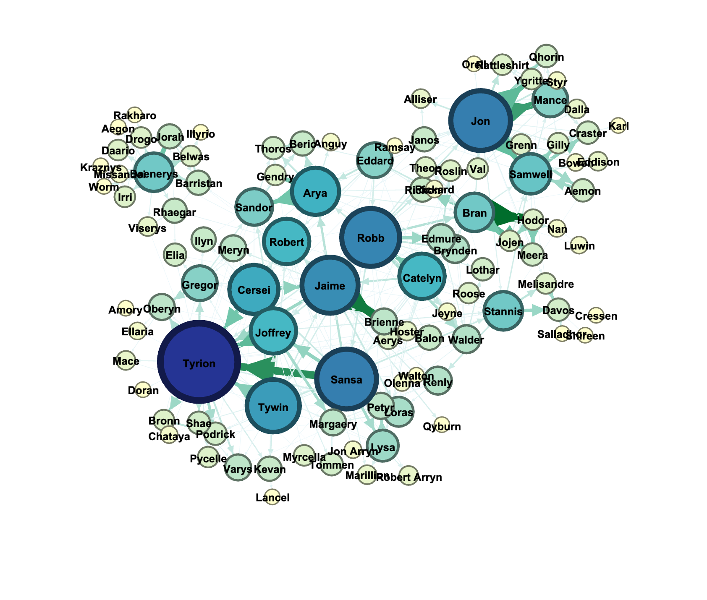
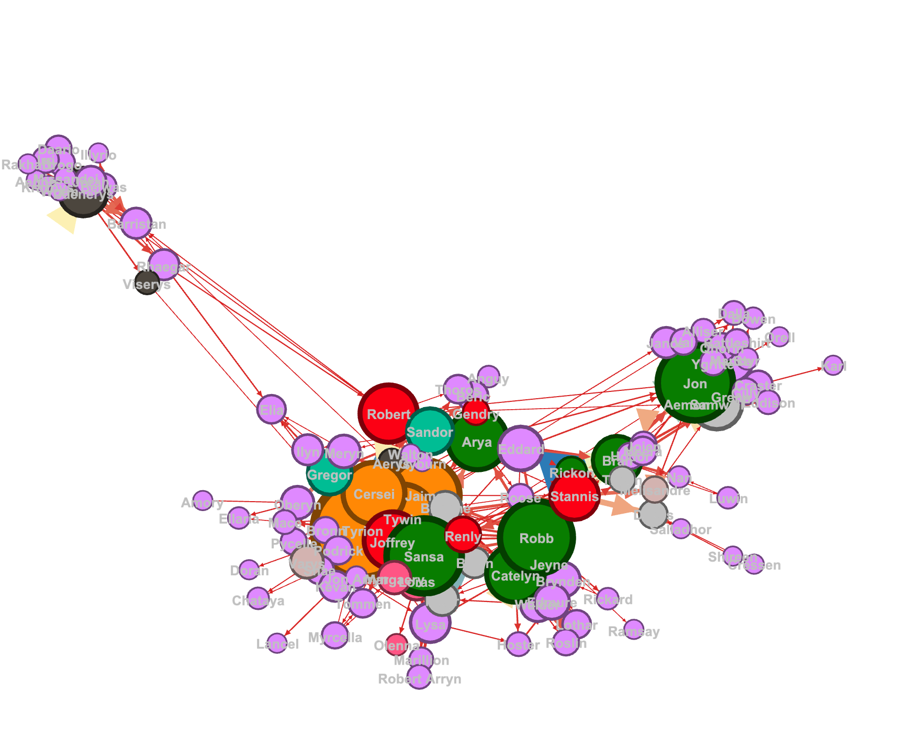
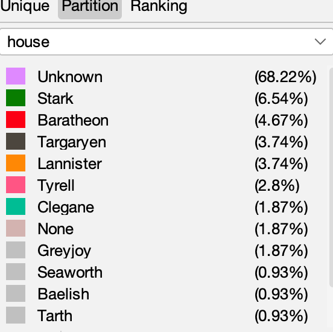

# A Song of Ice and Fire: Character Network Analysis

A network analysis in Gephi of character connections in George R. R. Martin's *A Song of Ice and Fire*. It maps who interacts with whom, sizes characters by how connected they are, and detects communities and house groupings in the story.

## The question

Which characters are the hubs of the story, and does the network of interactions split into the storylines and houses that readers recognize?

## Data

Two networks are included as Gephi-ready node and edge lists:

| Network | Nodes | Edges | Attributes |
|---|---|---|---|
| Full series (`asoiaf-all-*.csv`) | 796 characters | 2,823 undirected, weighted edges | Edge weight |
| Core cast (`got-*.csv`) | 107 characters | 352 weighted edges | House and allegiance per character; relationship type per edge (Interaction, Family, Alliance, Enemy, Brotherhood, and others) |

## Approach

1. Imported the node and edge lists into Gephi.
2. Laid out the graph with force-directed layouts (ForceAtlas / ForceAtlas 2) and sized nodes and labels by degree, so the most connected characters are the largest.
3. Ran Gephi's modularity (Louvain) community detection on the full network with edge weights on, resolution 1.0.
4. Colored the full network by community and rendered it with curved edges on a black background (`Thrones.pdf`).
5. For the core cast, colored nodes by house partition (`MostConnectedHouses.png`) and by connectedness (`MostConnectedCharacters.png`), with edge thickness reflecting weight.

## Key findings

- **Tyrion Lannister is the central hub.** He is the largest node in both the full-series graph and the core-cast graph, with Jon Snow, Robb, Sansa and Jaime among the next most connected in the core cast.
- **The full network splits into 12 communities** with a modularity score of 0.565, which indicates clear storyline clusters.
- **Storylines separate visually.** Jon Snow anchors a distinct Night's Watch and wildling cluster, and Daenerys Targaryen's cluster sits apart from the Westeros core, connected through only a few characters.
- **Most of the core cast has no house listed.** In the house partition, 68.22% of characters are "Unknown." Stark is the largest named house (6.54%), followed by Baratheon (4.67%), Targaryen (3.74%) and Lannister (3.74%).

  
  

The full 796-character community map is in [docs/Thrones.pdf](docs/Thrones.pdf).

## Tools

Gephi 0.10.1 (ForceAtlas and ForceAtlas 2 force-directed layouts, Label Adjust, modularity, degree ranking).

## Repository contents

| Path | Description |
|---|---|
| `ASOIAF.gephi` | Gephi project file for the full-series network, with layout, modularity and styling |
| `asoiaf-all-nodes.csv` | Node list for the full series (796 characters: Id, Label) |
| `asoiaf-all-edges.csv` | Edge list for the full series (2,823 weighted, undirected edges) |
| `got-nodes.csv` | Node list for the core cast (107 characters with House and Allegiance) |
| `got-edges.csv` | Edge list for the core cast (352 weighted edges with relationship type) |
| `docs/Thrones.pdf` | Full-series network colored by modularity community |
| `docs/MostConnectedCharacters.png` | Core-cast network sized and shaded by connectedness |
| `docs/MostConnectedHouses.png` | Core-cast network colored by house |
| `docs/HouseColors.png` | House color legend with each house's share of characters |

## Viewing the project

Open `ASOIAF.gephi` in [Gephi](https://gephi.org/) 0.10 or later. To rebuild from scratch, import the node and edge CSVs through *File > Import spreadsheet*.
